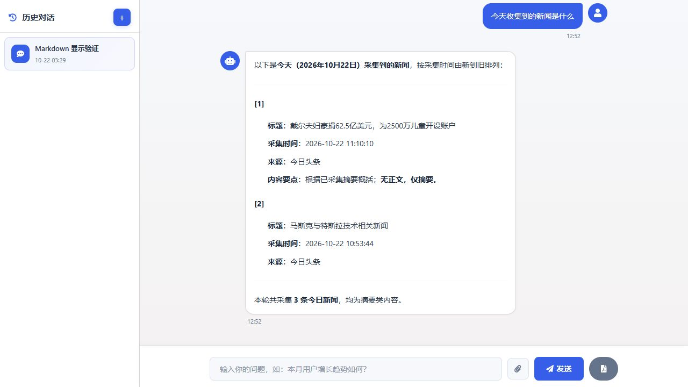

# InsightAgent · 智能瞭望与问数平台

基于 Python、Tornado 和 LangGraph 的信息采集与智能分析平台，支持新闻检索问答、关键词监测、文件分析与数字员工协作。

## 可以做什么

- **智能瞭望**：配置新闻数据源，采集新闻、提取正文，集中管理资料。
- **新闻问答**：检索已入库新闻，结合大模型生成带来源引用的回答，支持流式输出和连续追问。
- **关键词监测**：维护个人关注词、风险词和问题词，统计命中文章并辅助分析。
- **文件问数**：上传 CSV 等文件，计算数值统计，并通过自然语言提问和追问。
- **数字员工协作**：为员工配置角色、模型和 API 技能，在群聊中通过 @ 调用，支持天气查询等外部接口。
- **可视化与管理**：数据看板、图表展示、会话记录，以及用户、角色和菜单权限管理。

## 技术栈

| 层次 | 技术 |
| --- | --- |
| 后端 | Python 3.11、Tornado |
| Agent 与模型 | LangGraph、OpenAI SDK，兼容千问等 OpenAI 协议接口 |
| 数据存储 | SQLite，支持可选 MySQL / PyMySQL |
| 数据采集 | Requests、Beautiful Soup、Playwright |
| 前端 | HTML / CSS / JavaScript、Tornado 模板、Layui、jQuery |
| 数据可视化 | ECharts、ECharts GL、词云 |

## 项目亮点

- 使用 LangGraph 组织检索、业务工具、上下文准备和回答生成流程。
- 通过数据库关键词检索提供新闻证据，回答保留来源；当前未使用向量数据库。
- 文件统计由服务端计算，大模型负责解释，支持附件归属校验和会话绑定。
- 将角色、模型、API 技能与群聊结合，展示工作流型 Agent 的业务应用。

## 界面展示



## 快速启动

建议使用 Python 3.11，在项目根目录执行：

```bash
python -m pip install -r requirements.txt
python app.py
```

访问 http://localhost:10086 ，首次启动自动初始化数据库。演示管理员账号为 `admin`，密码为 `admin888`；用于本地演示，部署前请修改密码。

在「模型引擎」中填写自己的接口地址、模型名称和 API Key，即可使用模型问答。深度网页采集还需安装浏览器组件：

```bash
python -m playwright install chromium
```

仓库不包含模型密钥、本地数据库、用户上传文件或历史导出数据。
