# InsightAgent · 智能瞭望与问数平台

基于 Python、Tornado 和 LangGraph 的信息采集与智能分析平台，支持新闻检索问答、关键词监测、文件分析与数字员工协作。

## 可以做什么

- **智能瞭望**：配置新闻数据源，采集新闻、提取正文，集中管理资料。
- **新闻问答**：检索已入库新闻，结合大模型生成带来源引用的回答，支持流式输出和连续追问。
- **关键词监测**：维护个人关注词、风险词和问题词，统计命中文章并辅助分析。
- **文件问数**：上传 CSV 等文件，计算数值统计，并通过自然语言提问和追问。
- **数字员工协作**：为员工配置角色、模型和 API 技能，在群聊中通过 @ 调用，支持天气查询等外部接口。
- **可视化与管理**：数据看板、图表展示、会话记录，以及用户、角色和菜单权限管理。

## 技术栈

| 层次 | 技术 |
| --- | --- |
| 后端 | Python 3.11、Tornado |
| Agent 与模型 | LangGraph、OpenAI SDK，兼容千问等 OpenAI 协议接口 |
| 数据存储 | SQLite，支持可选 MySQL / PyMySQL |
| 数据采集 | Requests、Beautiful Soup、Playwright |
| 前端 | HTML / CSS / JavaScript、Tornado 模板、Layui、jQuery |
| 数据可视化 | ECharts、ECharts GL、词云 |

## 项目亮点

- 使用 LangGraph 组织检索、业务工具、上下文准备和回答生成流程。
- 通过数据库关键词检索提供新闻证据，回答保留来源；当前未使用向量数据库。
- 文件统计由服务端计算，大模型负责解释，支持附件归属校验和会话绑定。
- 将角色、模型、API 技能与群聊结合，展示工作流型 Agent 的业务应用。

## 如何绑定 API、创建资讯分析员和天气助手

配置分为两条流程：**模型接口 → 资讯分析员 → 新闻简报**；**天气接口 → API 技能 → 天气助手 → 实时查询**。员工需要在“数字员工”页面创建，技能页面的“AI 智能生成”用于辅助填写技能配置。

### 1. 先绑定大模型 API

进入 **模型引擎**，新增模型服务：

| 字段 | 填写方式 |
| --- | --- |
| 服务别名 | 自定义，例如“资讯分析模型”，用于在员工配置中选择 |
| 模型名称 | 模型服务商提供的模型 ID，不是服务别名 |
| API Key | 在本地填写自己的模型密钥，不放进 README 或截图 |
| Base URL | 服务商提供的 OpenAI 兼容接口基础地址 |

保存后点击该模型的 **测试**，发送“你好”，确认能收到回答。Base URL 填基础地址，不要额外拼接 `/chat/completions`。后面给资讯分析员绑定的，就是这里保存的模型服务。

### 2. 创建“资讯分析员”

进入 **数字员工 → 添加数字员工**，填写：

| 字段 | 示例配置 |
| --- | --- |
| 员工名称 | 资讯分析员 |
| 状态 | 启用 |
| 角色描述 | 根据已入库新闻整理简报，引用来源，区分正文与摘要；对证据不足的内容列出待核查项，不补写无依据的事实。 |
| 绑定模型 | 选择上一步测试成功的“资讯分析模型” |
| 绑定技能 | 基础新闻简报可先留空，新闻检索由系统现有流程提供 |

保存即完成员工创建。先通过智能瞭望采集新闻、保存到资料库，需要正文时再执行深度采集；资讯分析员会在回答新闻问题时检索已入库资料。

如果希望复用特定的简报风格，可在 **技能管理 → 创建技能** 中选择 `skill.md` 类型，通过“AI 智能生成”填写提示词技能，检查后保存，再回到员工配置中勾选绑定。基础新闻简报不需要先创建外部 API 技能。

### 3. 把天气 API 配置成技能

进入 **技能管理 → 创建技能**。下面给出与演示脚本一致的固定成都天气配置，直接手动填写即可：

| 字段 | 示例配置 |
| --- | --- |
| 技能名称 | 成都天气查询 · Open-Meteo |
| 技能类型 | `function_call`（外部 API 调用） |
| 分类 | `tool` |
| 功能描述 | 查询成都固定位置当前气温、体感温度、湿度、风速和降水量 |
| API 地址 | 使用下方完整 URL |
| 请求方法 | `GET` |
| 请求头 | `{}` |
| 请求体模板 | 留空 |
| 响应字段 | 留空，保留天气时间、单位和完整结构 |
| 状态 | 启用 |

```text
https://api.open-meteo.com/v1/forecast?latitude=30.67&longitude=104.06&current=temperature_2m,relative_humidity_2m,apparent_temperature,precipitation,wind_speed_10m&timezone=Asia%2FShanghai&forecast_days=1
```

此演示接口配置不需要模型密钥。请求固定查询成都当前天气，不会因用户输入“上海”而自动切换城市，也不查询历史或未来日期。

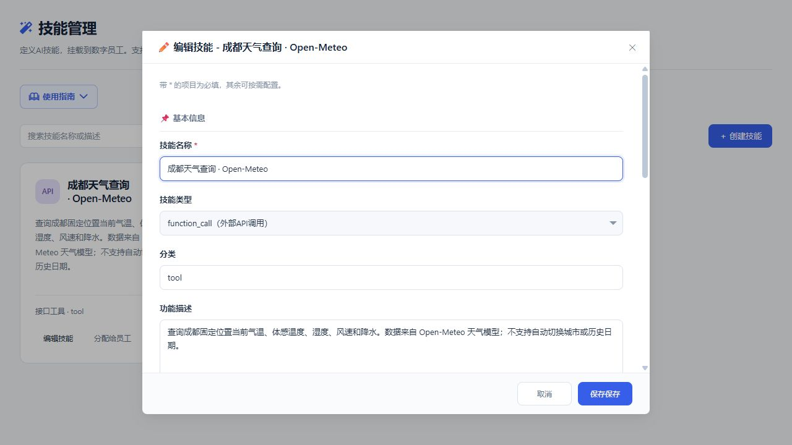

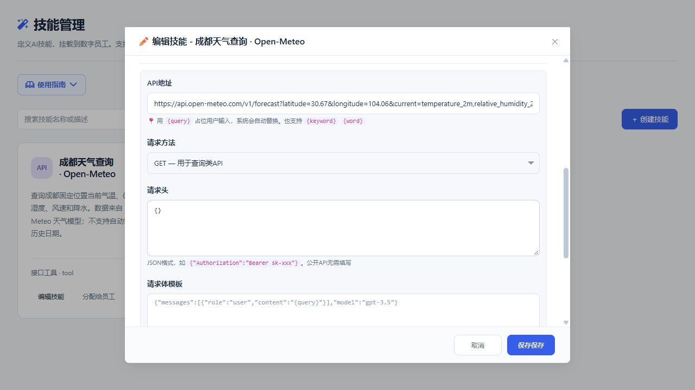

**也可以让 AI 辅助生成技能**：在创建技能窗口顶部选择已配置模型、`function_call` 类型和 `tool` 分类，填写以下生成要求，并将上方 URL 填入 API 详细提示，然后点击“AI 智能生成”：

> 创建“成都天气查询 · Open-Meteo”技能，使用我提供的完整 URL，GET 请求，请求头为 {}，请求体和响应字段留空。保留 current 数据、单位和时间。仅查询成都固定坐标的当前天气，不自动切换城市。

生成后逐项检查表单，尤其是 URL、请求方法和响应字段，再保存。**生成这份配置会调用所选模型；保存后的天气查询直接调用天气 API。**

### 4. 创建“成都天气助手”并绑定技能

进入 **数字员工 → 添加数字员工**：

| 字段 | 示例配置 |
| --- | --- |
| 员工名称 | 成都天气助手 |
| 状态 | 启用 |
| 角色描述 | 查询成都固定坐标当前天气，直接返回天气接口数据 |
| 绑定模型 | 未绑定；本例直接执行 API 技能 |
| 绑定技能 | 勾选“成都天气查询 · Open-Meteo” |

保存后重新打开员工配置，确认天气技能仍被勾选。

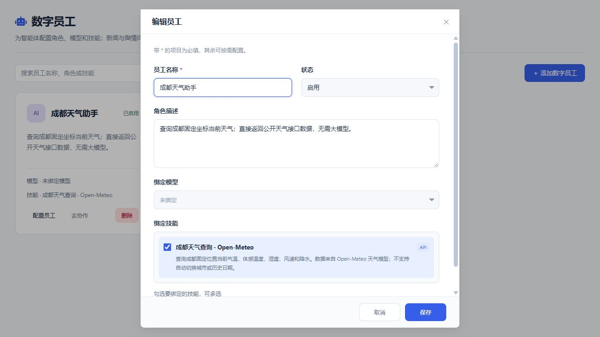

### 5. 邀请员工进群，再通过 @ 调用

1. 进入 **协作消息 → 发起群聊**，创建“人工智能资讯协作”群。
2. 打开群聊，点击 **邀请**，选择数字员工，把“资讯分析员”和“成都天气助手”加入群组。
3. 查看群成员，确认两名员工都已加入；仅创建员工还不能在群里调用。
4. 在输入框输入 `@`，从候选列表选择员工，补充任务并发送：

```text
@资讯分析员 请根据今天采集的人工智能新闻写一份简报，注明来源，并指出哪些内容还需要核查。

@成都天气助手 请查询成都现在的天气，列出气温、体感温度、湿度、风速和降水量。
```

资讯分析员返回带新闻来源的简报，天气助手返回带时间和单位的接口数据，实际效果见下方联动展示。若员工没有回复，先检查是否已启用、已入群，以及模型或技能是否绑定成功。

已有账号也可以在首次启动项目后，用脚本创建天气技能、天气助手和演示群：

```bash
python scripts/setup_weather_demo.py --username admin
```

脚本只创建配置，不调用模型或天气接口；创建完成后仍需进入群聊发送查询。

## 功能联动展示

下面用同一批“人工智能”新闻串起采集、问答、监测、文件分析与群聊协作。截图保留 **2026-10-22 的实际运行结果**，用于展示系统流程；天气与新闻数量均为当次记录。

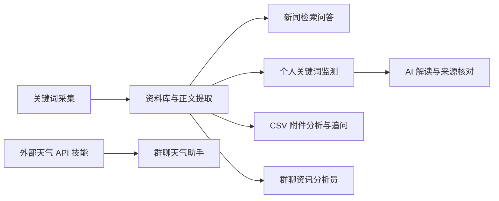

### 1. 采集新闻 → 入库 → 提取正文

在智能瞭望中输入“人工智能”，选择百度新闻，勾选采集结果并保存到资料库。本次保存 **10 条新闻**；再进入深度采集，为其中 **2 条**提取正文，供后续问答与简报使用。

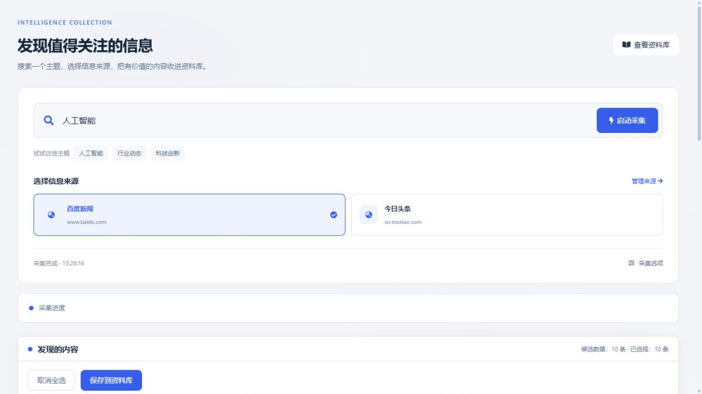

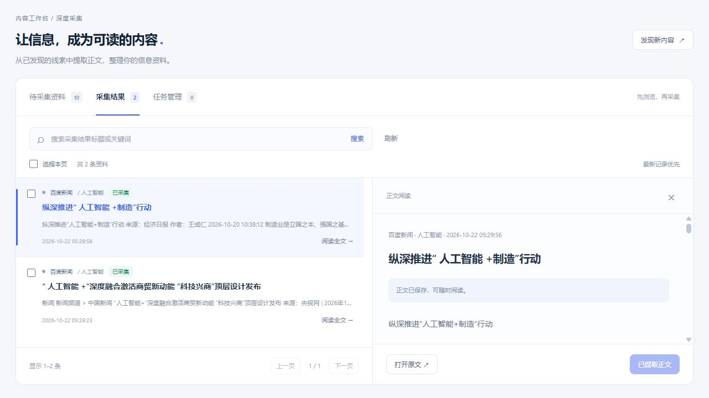

**联动效果**：采集得到的标题、摘要与正文进入同一个资料库，个人问答和群聊员工可以检索这些资料。只有摘要的新闻按摘要使用，不将其当成完整正文。

### 2. 资料库 → 新闻问答 → 依据正文继续追问

**第一次提问**：

> 今天采集的人工智能新闻有哪些？列出10条标题和采集时间，用表格展示，不扩展标题以外的信息。

系统在当天范围内检索，返回标题、采集时间和来源引用。截图展示表格局部，实际回答列出10条资料。

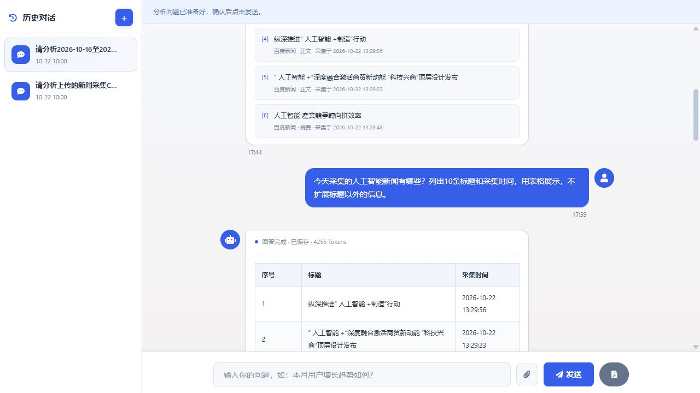

**同一会话继续追问**：

> 请依据今天采集的制造业相关新闻正文，总结纵深推进人工智能加制造行动的三个重点方向。不要引用标题以外无证据的数据，150字以内。

**当次回答要点**：抓技术供给、抓赋能应用、统筹发展与安全，并引用已提取的新闻正文。

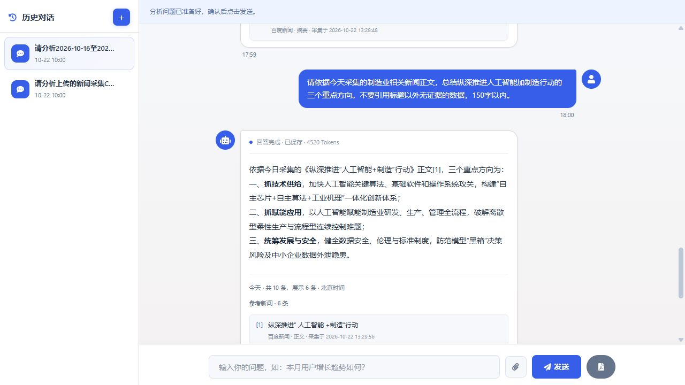

**联动效果**：LangGraph 串起检索、业务工具、上下文准备和流式回答；回答保留来源，方便回到资料核对。

### 3. 个人关键词库 → 阶段监测 → AI 解读

在舆情洞察中配置“人工智能”为关注词、“污染”为风险词、“弊病”为问题词，选择 **2026-10-16 至 2026-10-22**，保存并匹配。

| 关键词 | 分类 | 当次命中文章数 |
| --- | --- | --- |
| 人工智能 | 关注词 | 10 |
| 污染 | 风险词 | 1 |
| 弊病 | 问题词 | 2 |

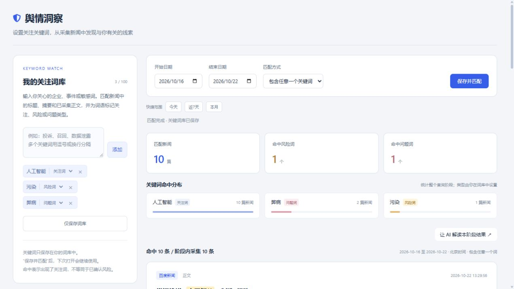

点击“让 AI 解读本阶段结果”，页面将日期范围与分析问题带入个人问答，由用户确认发送：

> 请分析2026-10-16至2026-10-22我的舆情关注词监测结果，说明人工智能、污染、弊病分别命中多少篇新闻，区分词语命中与已核实风险。引用来源，180字以内。

**当次结果**：回答结合全量命中统计与文章片段解释线索，指出“词语出现”不等于“风险已经成立”，并展示对应来源。

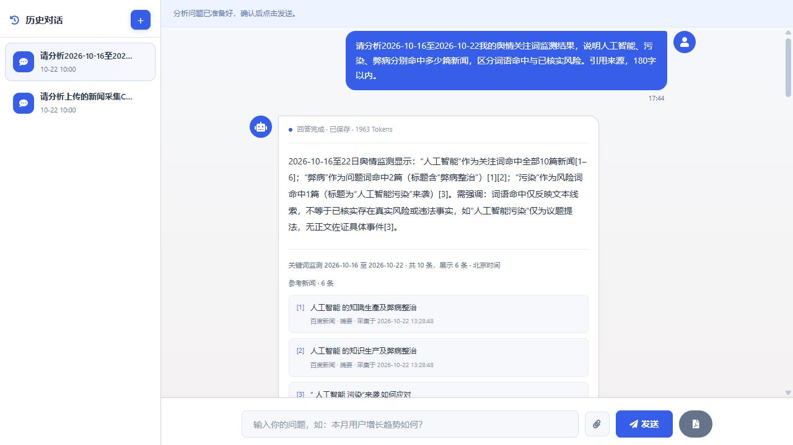

**联动效果**：词库、日期筛选、数据库统计与模型解释衔接起来；个人词库按用户隔离，不带入群聊。

### 4. 同批新闻 CSV → 文件空间 → 统计分析与追问

将同批新闻整理为 [collected-news.csv](docs/examples/collected-news.csv)，上传到文件空间并用于问答：

> 再核对一次同一附件的基本统计：新闻总条数、标题字数合计、污染命中条数、弊病命中条数、已提取正文条数。用两列表格，文档引用只使用[1]；具体行号写作第N行。

**当次结果**：共10条新闻，标题字数合计215字，“污染”命中1条，“弊病”命中2条，已提取正文2条，回答附带文件引用与行号。

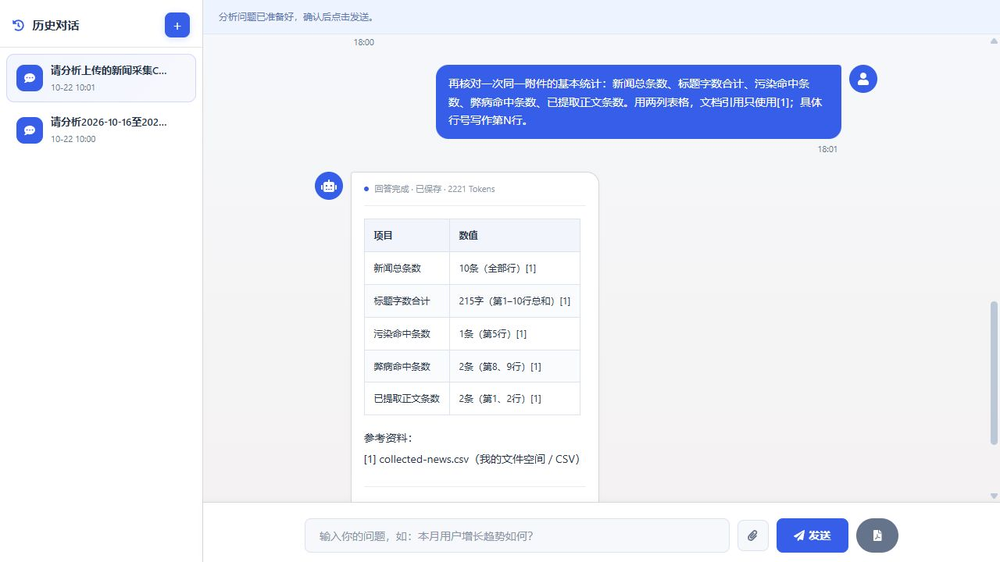

**继续追问**：

> 继续根据同一个附件计算：污染命中率、弊病命中率和正文提取覆盖率分别是多少？说明这些数字是否等同于真实风险比例。文档只引用[1]，180字以内。

**当次结果**：分别为 **10%、20%、20%**，并明确这些是关键词匹配率和正文覆盖率，不能直接解释为真实风险比例。

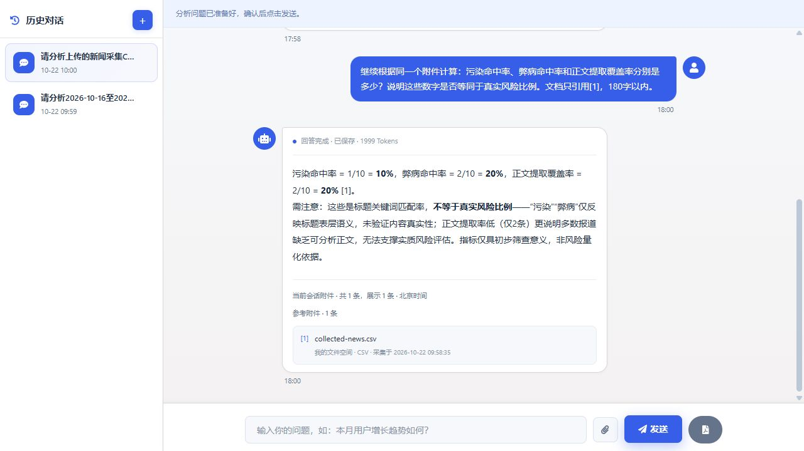

**联动效果**：附件绑定会话，继续追问时重新读取；服务端负责基础数值统计，大模型负责解释结果。

### 5. 数字员工 → 同一群聊中的新闻简报与 API 工具

创建“资讯分析员”和“成都天气助手”，分别绑定角色与模型、天气 API 技能，再邀请到同一个协作群。

**任务一：@资讯分析员 生成新闻简报。** 员工复用新闻检索流程，结合已入库正文生成简报，列出来源和待核查项。

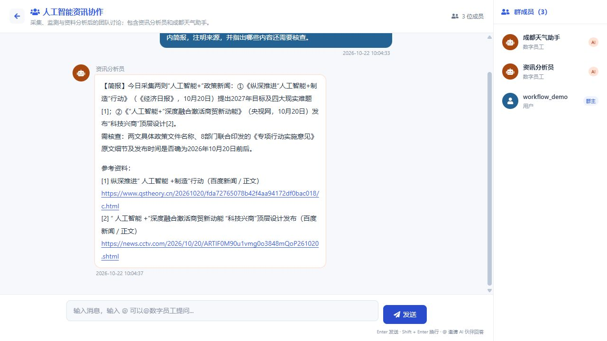

**任务二：@成都天气助手 查询当前天气。** 员工调用绑定的 Open-Meteo API，返回气温、体感温度、湿度、风速、降水量及数据时间。截图中的18.1°C是当次接口结果。

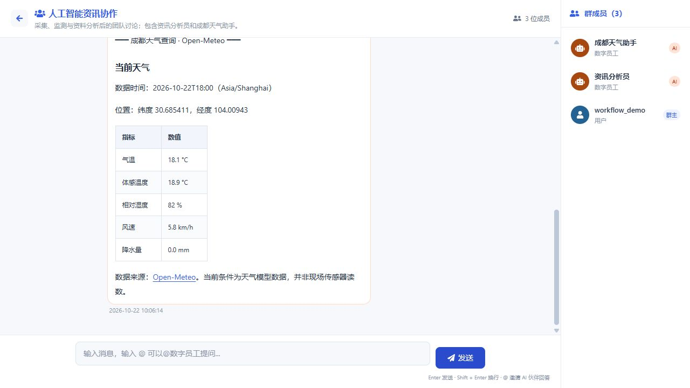

**联动效果**：同一个群中可以按员工分工调用新闻分析与外部工具；新闻简报经过模型生成，固定天气查询直接执行 API 技能，不消耗大模型 Token。结果保存到群聊历史，便于后续查看。

## 快速启动

建议使用 Python 3.11，在项目根目录执行：

```bash
python -m pip install -r requirements.txt
python app.py
```

访问 http://localhost:10086 ，首次启动自动初始化数据库。演示管理员账号为 `admin`，密码为 `admin888`；用于本地演示，部署前请修改密码。

在「模型引擎」中填写自己的接口地址、模型名称和 API Key，即可使用模型问答。深度网页采集还需安装浏览器组件：

```bash
python -m playwright install chromium
```

仓库不包含模型密钥、本地数据库、用户上传文件或历史导出数据。
